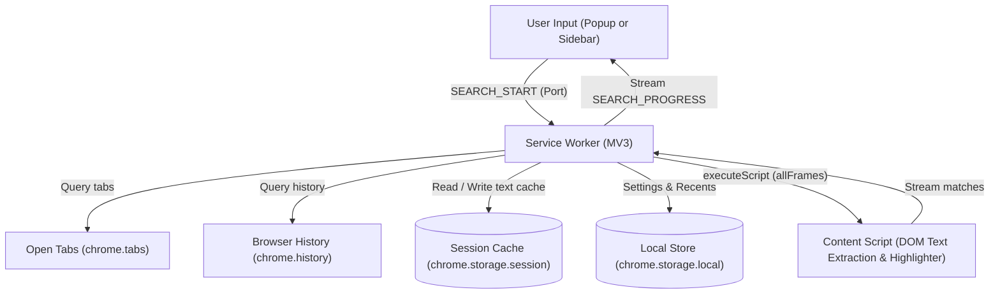

# PowerSearch ⚡

[](LICENSE)
[](https://developer.chrome.com/docs/extensions/mv3/intro/)
[](https://www.typescriptlang.org/)
[](https://preactjs.com/)
[](https://vitejs.dev/)
[-brightgreen.svg)](extension/tests)

> **Instantly search across all your open tabs and browser history with a single keyboard shortcut.**  
> Find any tab in seconds. Privacy-first, local-only full-text search. No account or login required.

---

## 🌟 Overview

Have dozens or hundreds of tabs open across multiple windows? Finding what you need shouldn't mean manually clicking through every single tab.

**PowerSearch** indexes and searches the text content of every open tab simultaneously, alongside your browser history, right from your keyboard. When you select a result, PowerSearch switches directly to the tab and smoothly scrolls to the exact match highlighted on the page.

---

## ✨ Features

- **⚡ Instant Full-Text Tab Search**: Searches tab titles, URLs, and in-page DOM text (including iframes and shadow DOM).
- **🕒 Browser History Search**: Seamlessly search your browsing history in parallel without leaving your current workflow.
- **🎯 In-Page Match Highlighting**: Jumps directly to matching words with custom highlight color presets (Yellow, Blue, Green, Pink) and in-page match counters.
- **🪟 Two Display Modes**:
  - **Floating Popup**: Fast and keyboard-centric. Opens with a shortcut, jumps to results, and automatically closes.
  - **Persistent Sidebar (Side Panel)**: Stays open alongside web pages while you browse and switch tabs.
- **🔍 Advanced Filters**: Filter results by domain/website or date range for history.
- **📌 Pinned Searches & Autocomplete**: Pin your most frequent searches or autocomplete from recent queries.
- **⌨️ Keyboard-First Navigation**: Full keyboard navigation support (cycle results, copy snippets, switch search scopes).
- **🖱️ Context Menu Search**: Highlight any text on any webpage, right-click, and select *"Search in PowerSearch"*.
- **🎨 Theme Support**: Automatically respects system dark/light theme or can be manually overridden.
- **🔒 Privacy by Design**: All search queries, indexed text, and history remain strictly on your local device. **Zero telemetry, zero analytics, zero external API calls.**

---

## 🔒 Privacy & Security

PowerSearch is built with a strict privacy-first model:
- **100% Local**: All page text extraction, indexing, and substring matching occur entirely within your local browser profile.
- **No Telemetry**: No tracking scripts, analytics SDKs, error trackers, or third-party beacons.
- **Session Cache**: Page text cache is kept in temporary browser session storage with an LRU cap of 50 tabs and a 5-minute TTL.
- **Isolated**: Content scripts operate without external network requests.

---

## 🚀 Getting Started

### Option A: Install from Chrome Web Store
Install the verified build directly from the [Chrome Web Store](https://chromewebstore.google.com/detail/khfikkkbfobhkohjbjindgnplohhpcjn).

### Option B: Load Unpacked (Development)
1. Clone this repository:
   ```bash
   git clone https://github.com/husain3012/PowerSearch.git
   cd PowerSearch/extension
   ```
2. Install dependencies and build:
   ```bash
   npm install
   npm run build
   ```
3. Open your browser and navigate to:
   - **Chrome**: `chrome://extensions/`
   - **Edge**: `edge://extensions/`
   - **Brave**: `brave://extensions/`
4. Enable **Developer mode** (toggle in the top-right corner).
5. Click **Load unpacked** and select the `PowerSearch/extension/dist` folder.
6. Open any webpage and press `Ctrl+Shift+F` (or `Cmd+Shift+F` on macOS) to launch!

---

## ⌨️ Keyboard Shortcuts

| Shortcut | Description |
|---|---|
| `Ctrl+Shift+F` / `Cmd+Shift+F` | Open PowerSearch (configurable via `chrome://extensions/shortcuts`) |
| `↓` / `↑` | Navigate between search results and group headers |
| `Enter` | Trigger search or navigate to selected match |
| `Esc` | Clear search input / close popup |
| `Alt+1` / `Alt+2` / `Alt+3` | Switch scope between **All**, **Tabs**, and **History** |
| `Cmd+C` / `Ctrl+C` | Copy highlighted snippet when snippet is focused |
| `★` click or `Cmd+S` | Pin / unpin current search query |

---

## 🛠️ Tech Stack & Architecture

- **Runtime**: Chrome Extensions Manifest V3
- **Language**: TypeScript 5.4
- **UI Framework**: Preact 10 (lightweight React alternative, ~3kB)
- **Build System**: Vite 5 + [@crxjs/vite-plugin](https://crxjs.dev/vite-plugin)
- **Testing**: Vitest 4 with comprehensive in-memory Chrome API mocks
- **Storage**: `chrome.storage.session` (ephemeral page text cache) and `chrome.storage.local` (settings, pinned queries)



---

## 📁 Repository Structure

```
PowerSearch/
├── .github/                      # GitHub issue/PR templates and CI workflow
│   ├── ISSUE_TEMPLATE/
│   │   ├── bug_report.md
│   │   └── feature_request.md
│   ├── pull_request_template.md
│   └── workflows/
│       └── ci.yml
├── chrome-store-docs/            # Store documentation & legal policies
│   ├── PRIVACY_POLICY.md
│   ├── SUPPORT.md
│   └── TERMS_AND_CONDITIONS.md
├── docs/                         # Additional documentation
├── extension/                    # Main extension source code
│   ├── public/                   # Extension icons and static assets
│   ├── src/
│   │   ├── background/           # Service worker, search engine, storage, indexer
│   │   ├── content/              # Content scripts (DOM text extraction & highlighting)
│   │   ├── onboarding/           # First-install onboarding flow
│   │   ├── popup/                # Preact UI (Search bar, results, filters, settings)
│   │   ├── platform.ts           # OS and browser detection utilities
│   │   └── types.ts              # Shared TypeScript definitions
│   ├── tests/                    # Automated unit & integration tests
│   ├── manifest.json             # Manifest V3 configuration
│   ├── package.json              # Extension dependencies & scripts
│   ├── tsconfig.json             # TypeScript compiler configuration
│   ├── vite.config.ts            # Vite + CRXJS build configuration
│   └── vitest.config.ts          # Vitest testing configuration
├── architecture.md               # Detailed technical architecture specification
├── MAINTAINING.md                # Maintainer release and store submission guide
├── CONTRIBUTING.md               # Contributor guidelines
├── CODE_OF_CONDUCT.md           # Contributor Covenant Code of Conduct
├── SECURITY.md                   # Security vulnerability reporting policy
├── LICENSE                       # MIT License
└── README.md                     # Project documentation
```

---

## 🧪 Testing

The project includes an extensive automated test suite covering MV3 compliance, search algorithms, storage LRU eviction, platform detection, and package integrity:

```bash
# Run tests
npm test

# Run tests with coverage report
npm run test:coverage
```

All 9 test suites and 170+ unit tests run in headless environments with zero browser dependency thanks to comprehensive Chrome API mocks.

---

## 🤝 Contributing

Contributions are welcome! Please read our [Contributing Guide](CONTRIBUTING.md) and [Code of Conduct](CODE_OF_CONDUCT.md) before submitting pull requests.

1. Fork the repository.
2. Create your feature branch (`git checkout -b feature/amazing-feature`).
3. Commit your changes (`git commit -m 'Add amazing feature'`).
4. Ensure all tests pass (`npm test`).
5. Push to the branch (`git push origin feature/amazing-feature`).
6. Open a Pull Request.

---

## 📄 License

This project is open-source software licensed under the [MIT License](LICENSE).

